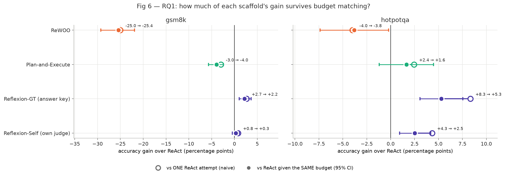
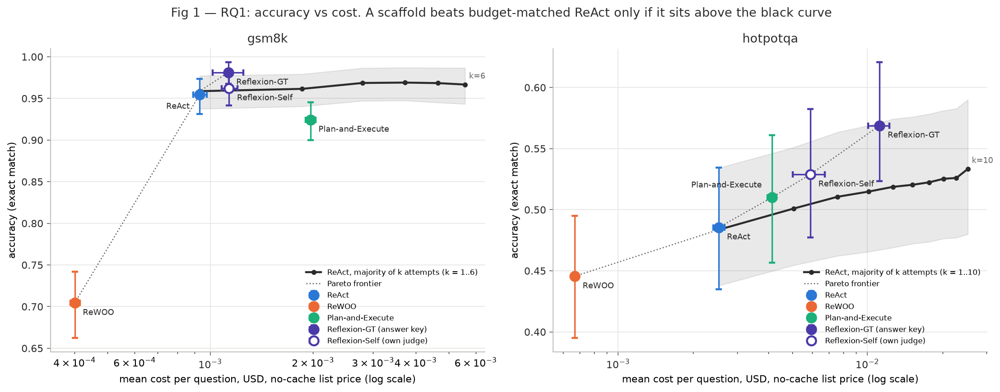
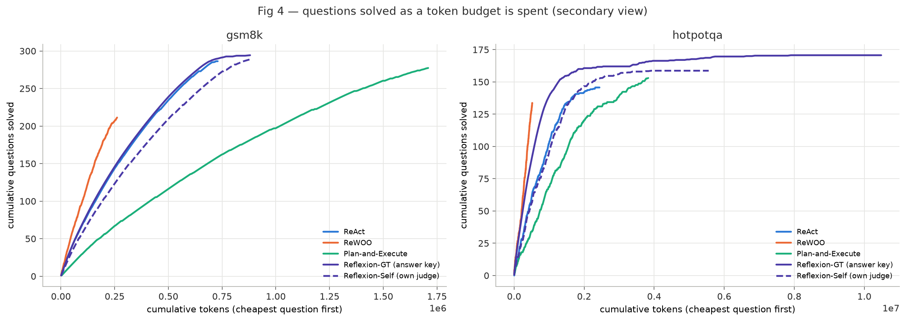
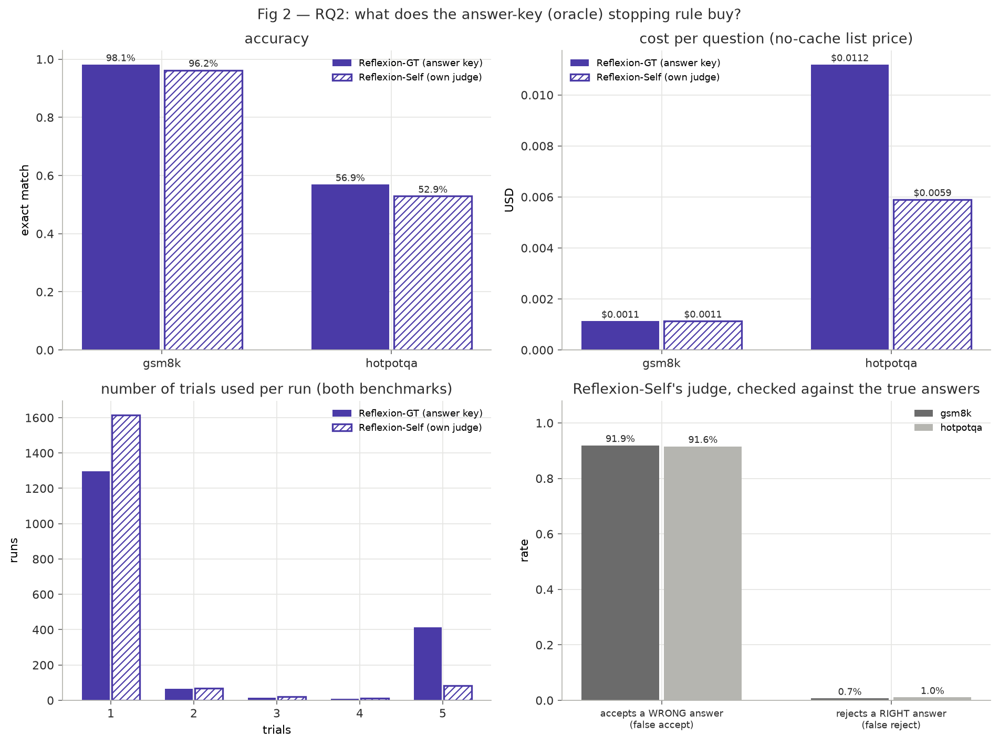
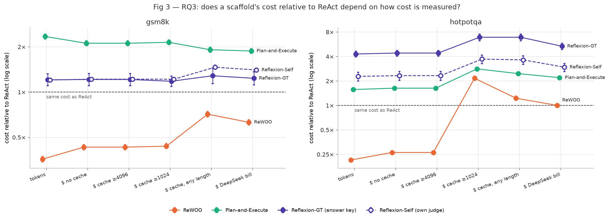
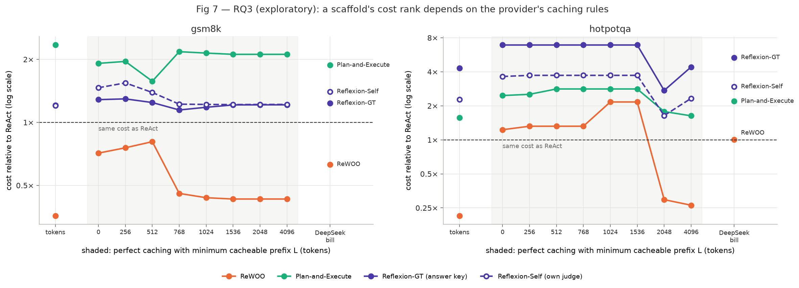
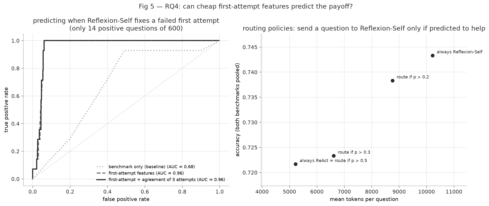

# Research Questions, Methods and Results

**Study:** A budget-matched, oracle-free comparison of LLM agent scaffolds
**Data:** `results/main/` — 12,000 runs, 54,597 LLM calls, 0 runs dropped
**Pre-registration:** `PREREGISTRATION.md`, commit `6656be0` (frozen before any run)
**All numbers and figures** are regenerated by `python -m acs.analysis.report --run-tag main`
(figures in `results/main/analysis/`).

---

## 0. The common setup (applies to every RQ)

### 0.1 The overarching question

> When comparing LLM agent scaffolds, how much of one scaffold's apparent advantage is real,
> once we control for **(i) how much compute it spends**, **(ii) whether it secretly uses the
> answer key**, and **(iii) how cost is actually measured**?

Each RQ isolates one of these, plus a fourth asking whether the payoff is predictable.

### 0.2 What was held fixed

| Factor | Value |
|---|---|
| Model | `deepseek-flash` (DeepSeek-V4.1-Flash), thinking mode disabled on every call |
| Sampling | temperature 0.7 for every generative call; 0.0 for the judge |
| Benchmarks | **HotpotQA** (multi-hop Wikipedia questions, tool-heavy), **GSM8K** (maths word problems, reasoning-heavy) |
| Tasks | 300 per benchmark, fixed random sample (seed 2026), HotpotQA stratified by question type |
| Tools | HotpotQA: `Search[entity]` (first 5 sentences of the Wikipedia page), `Lookup[keyword]`; GSM8K: `Calculate[expr]`. ReWOO additionally has its `LLM[...]` worker. Every Wikipedia response is disk-cached, so all scaffolds see identical content |
| Prompts | original papers' prompts where they exist (ReAct, ReWOO, Reflexion), plus one identical answer-style line for all |
| Limits | ReAct ≤ 7 steps; ReWOO ≤ 8 plan steps; Plan-Exec ≤ 5 plan steps × ≤ 4 actions; Reflexion ≤ 5 trials, memory of 3 reflections |
| Grading | HotpotQA: official exact match (EM, primary) and F1; GSM8K: last number in the answer equals the gold number |

### 0.3 The five arms (the only thing that varies)

| Arm | Control flow | Runs per question |
|---|---|---|
| **ReAct** | Thought → Action → Observation loop in one growing conversation | 10 (HotpotQA) / 6 (GSM8K) — the "pool" |
| **ReWOO** | One planner call writes all tool calls (`#E1 = Search[...]`), tools run without the model, one solver call answers | 3 |
| **Plan-and-Execute** | Planner writes ≤ 5 sub-tasks, a small ReAct loop solves each, the same solver as ReWOO answers | 3 |
| **Reflexion-GT** | ReAct trial → stop if the answer **matches the answer key**, else self-reflect and retry | 3 |
| **Reflexion-Self** | Identical, but stop if an **LLM judge (no answer key)** says the answer is correct | 3 |

Reflexion's first trial **is** ReAct pool attempt *r* (same prompt, same distribution), which makes comparisons paired.

### 0.4 What every call and run records

- **`calls.jsonl`** (one row per LLM call): input tokens split into cache-miss and cache-hit, output tokens, role, conversation id and turn, latency, attempt id.
- **`runs.jsonl`** (one row per run): final answer, correctness, number of calls, tools, steps, trials, judge verdicts, the full trace.

### 0.5 Shared statistical method

| Item | Definition |
|---|---|
| Per-question score | mean correctness over that arm's replicates (ReAct baseline uses pool attempts 0–2) |
| Accuracy | mean of per-question scores over the 300 questions |
| Δ (delta) | paired difference: arm A − arm B, computed per question, then averaged |
| 95% CI | cluster bootstrap over questions, B = 2,000 resamples, seed 2026 |
| p-value | two-sided bootstrap p, `(count + 1)/(B + 1)` per tail (smallest reportable ≈ 0.001) |
| Multiple comparisons | Holm–Bonferroni across the **9 pre-registered comparisons per benchmark** |
| Secondary test | exact McNemar test on replicate 0 (right/wrong disagreements) |
| pp | percentage points |

### 0.6 Experiments performed (in order)

| # | Experiment | Size | Outcome |
|---|---|---|---|
| 1 | Pilot 1 | 30 questions per benchmark, ReAct ×3, others ×1 (420 runs) | **NO-GO**: 77% of ReAct HotpotQA runs had a rejected action (model wrote `Search[X]` without the `Action N:` label). Parser made tolerant, identically for all arms; no prompt changed |
| 2 | Pilot 2 | same (420 runs) | **GO**: rejected actions 3.3%, ReAct HotpotQA EM 48.9%, 0 errors; budget configuration chosen (GSM8K pool 10 → 6) |
| 3 | Main run, attempt 1 | HotpotQA pool (3,000 runs) | **Aborted**: 82% failed from Wikipedia HTTP 429 rate limiting. Discarded entirely (survivor bias); retry/cooldown and per-attempt billing added |
| 4 | **Main run** | 12,000 runs, 54,597 calls | 0 errors, 0 dropped; $3.64 billed |
| 5 | Analysis | — | everything below; two analysis-code bugs (Holm p = 0 → 1; bootstrap p = 0) fixed before interpretation |

---

## RQ1 — Does any scaffold beat ReAct *at the same budget*?

### The question

> Is a scaffold's accuracy advantage over ReAct caused by its **design**, or merely by the fact
> that it **spends more compute**?

### The hypothesis (H1, pre-registered)

> For each scaffold X whose naive gain over ReAct is positive, comparing X instead against ReAct
> **given the same token budget** removes **at least half** of that gain:
> `Δmatch(X) ≤ 0.5 × Δdef(X)`.

- `Δdef(X)` = Acc(X) − Acc(one ReAct attempt) — the naive comparison other papers report.
- `Δmatch(X)` = Acc(X) − Acc(ReAct majority vote at X's token cost) — the fair comparison.
- **Pass/fail rule:** evaluated on point estimates, only for rows with `Δdef > 0`. The "half" threshold is a pre-set falsification line, not derived from theory.

**Why we expected it.** Kapoor et al. (2024) showed simple retry baselines often match complex agents at equal cost; Hajimiri et al. (2026) found memory-module gains vanish against a token-matched baseline; Dong & Shigida (2026) found independent sampling beats agentic reasoning at fixed budget.

### Technical approach

1. **Build ReAct's budget curve without extra runs.** For each question, ReAct has a pool of K independent attempts (K = 10 HotpotQA, 6 GSM8K).
2. **vote@k** (`analysis/vote.py`): for k = 1…K, draw k distinct attempts at random (200 draws per question), take the **majority answer** (answers compared after official normalisation; empty answers don't vote; ties go to the earliest-drawn attempt), and grade it. Cost of vote@k = sum of the k attempts' costs. Averaging over draws gives an unbiased accuracy and cost for every k.
3. **Match the budget** (`metrics.matched_control`): find **k\*** such that vote@k\* costs the same mean tokens per question as X, interpolating linearly between whole k (so k\* can be 2.29).
4. **Compare paired** (`metrics.h1_table`): per question, X's score minus vote@k\*'s expected score → Δmatch with cluster-bootstrap CI; same for Δdef against one ReAct attempt.
5. **Test** the 8 comparisons (4 arms × {naive, matched}) per benchmark inside the Holm family.
6. **Exploratory extension:** repeat the matching on the actual dollar bill instead of tokens.

### Results

**Accuracy and cost of every arm**

| Benchmark | Arm | Accuracy [95% CI] | Tokens / question | LLM calls / question | $ / question (no-cache list) |
|---|---|---|---|---|---|
| HotpotQA | ReAct (1 attempt) | 48.6% [43.2, 53.7] | 8,128 | 4.27 | 0.0025 |
| HotpotQA | ReWOO | 44.6% [39.2, 49.4] | 1,732 | 3.52 | 0.0007 |
| HotpotQA | Plan-and-Execute | 51.0% [45.7, 56.2] | 12,767 | 8.38 | 0.0041 |
| HotpotQA | Reflexion-GT | 56.9% [51.9, 61.9] | 34,937 | 15.10 | 0.0112 |
| HotpotQA | Reflexion-Self | 52.9% [47.7, 58.1] | 18,522 | 9.12 | 0.0059 |
| HotpotQA | ReAct vote@3 / @5 / @10 | 51.1% / 51.9% / 53.3% | 24,294 / 40,497 / 80,961 | — | 0.0076 / 0.0126 / 0.0253 |
| GSM8K | ReAct (1 attempt) | 95.4% [93.1, 97.4] | 2,432 | 3.31 | 0.0009 |
| GSM8K | ReWOO | 70.4% [66.2, 74.3] | 871 | 2.12 | 0.0004 |
| GSM8K | Plan-and-Execute | 92.4% [90.0, 94.8] | 5,696 | 8.62 | 0.0020 |
| GSM8K | Reflexion-GT | 98.1% [96.8, 99.3] | 2,934 | 3.82 | 0.0011 |
| GSM8K | Reflexion-Self | 96.2% [94.2, 98.0] | 2,926 | 4.38 | 0.0011 |
| GSM8K | ReAct vote@3 / @5 | 96.9% / 96.8% | 7,281 / 12,126 | — | 0.0028 / 0.0047 |

**Naive vs budget-matched gains (H1 table)**

| Benchmark | Scaffold | k\* | Δdef vs 1 ReAct [95% CI] | Holm p | McNemar p | Δmatch vs vote@k\* [95% CI] | Holm p | Share of gain removed | H1 |
|---|---|---|---|---|---|---|---|---|---|
| HotpotQA | ReWOO | 1.00 | −4.0 [−7.7, −0.3] | 0.12 | 0.19 | −3.8 [−7.4, −0.2] | 0.12 | — | n/a (no gain) |
| HotpotQA | Plan-and-Execute | 1.58 | +2.4 [−0.4, +5.4] | 0.21 | 0.52 | +1.6 [−1.2, +4.5] | 0.28 | 33% | **No** |
| HotpotQA | Reflexion-GT | 4.31 | **+8.3 [+6.0, +10.9]** | 0.009 | <0.001 | **+5.3 [+3.1, +7.5]** | 0.009 | 37% | **No** |
| HotpotQA | Reflexion-Self | 2.29 | **+4.3 [+2.7, +6.3]** | 0.009 | 0.002 | **+2.5 [+0.9, +4.2]** | 0.009 | 42% | **No** |
| GSM8K | ReWOO | 1.00 | −25.0 [−28.9, −21.3] | 0.009 | <0.001 | −25.4 [−29.3, −21.9] | 0.009 | — | n/a (no gain) |
| GSM8K | Plan-and-Execute | 2.35 | −3.0 [−4.8, −1.4] | 0.009 | 0.09 | −4.0 [−5.7, −2.4] | 0.009 | — | n/a (no gain) |
| GSM8K | Reflexion-GT | 1.21 | **+2.7 [+1.3, +4.3]** | 0.009 | 0.03 | **+2.2 [+1.0, +3.6]** | 0.009 | 18% | **No** |
| GSM8K | Reflexion-Self | 1.21 | +0.8 [−0.0, +1.8] | 0.18 | 1.00 | +0.3 [−0.5, +1.1] | 0.46 | 62% | Yes (gain not significant) |

(k\* = 1.00 for ReWOO means it is cheaper than one ReAct attempt, so the matched control is one attempt. No arm needed k\* beyond the pool.)

**Exploratory — matched on the actual dollar bill instead of tokens** (`exploratory_dollar_matched.csv`, point estimates):

| Benchmark | Scaffold | k\* (tokens → dollars) | Δmatch (tokens → dollars) |
|---|---|---|---|
| HotpotQA | Plan-and-Execute | 1.58 → 2.20 | +1.6 → +0.7 |
| HotpotQA | Reflexion-GT | 4.31 → 5.36 | +5.3 → +5.0 |
| HotpotQA | Reflexion-Self | 2.29 → 2.96 | +2.5 → +1.9 |
| GSM8K | Reflexion-GT | 1.21 → 1.23 | +2.2 → +2.2 |

### Figures

**Fig 6** — the clearest view of RQ1. Hollow dot = gain over one ReAct attempt; filled dot = gain over ReAct at the same budget (with 95% CI); the line between them is the gain that budget matching removed.

**Fig 1** — accuracy against cost. The black curve is ReAct's majority vote over k attempts (grey band = 95% CI). A scaffold beats budget-matched ReAct only if it sits **above** the curve at its own cost. Dotted line = Pareto frontier.

**Fig 4** (secondary) — questions solved as a token budget is spent, cheapest question first.

### Answer to RQ1

- **Only Reflexion beats ReAct at the same budget**, on both benchmarks, and significantly after Holm correction: HotpotQA +5.3 pp (GT) and +2.5 pp (Self), GSM8K +2.2 pp (GT).
- **Plan-and-Execute never does** (HotpotQA +1.6 pp, not significant; GSM8K −4.0 pp). **ReWOO is always worse** (−3.8 pp HotpotQA, n.s. after Holm; −25.4 pp GSM8K).
- **Budget matching removes 18–42% of every significant gain** — real, but less than the ≥ 50% predicted. Matched on actual dollars, the gains shrink further (Reflexion-Self: +1.9 pp).
- **H1: not supported.** It fails for all three significant gains and for HotpotQA Plan-and-Execute; it holds only for GSM8K Reflexion-Self, whose naive gain was never significant.

---

## RQ2 — How much of Reflexion's gain comes from the answer key?

### The question

> Reflexion's original HotpotQA setup stops retrying when the answer **matches the answer key** —
> information no deployed system has. How much accuracy (and what cost) does this oracle account
> for, compared with a realistic version that must judge its own answers?

### The hypothesis (H2, pre-registered)

> `Acc(Reflexion-GT) − Acc(Reflexion-Self) > 0`.
> The **cost** direction was deliberately not predicted: a lenient judge stops early (cheaper);
> a strict judge wastes retries (costlier). We pre-registered reporting the **judge's error
> rates against the true answers** as the explanation.

**Why we expected it.** Reflexion's own code uses `is_correct = EM(answer, key)` to stop (verified in their repository); Simhadri (2026) does the same and admits it is not deployment-realistic; Huang et al. (2024) showed LLMs rarely self-correct without external feedback.

### Technical approach

1. **Two Reflexion variants identical except for the stop signal** (`scaffolds/reflexion.py`):
   - Reflexion-GT: after each trial, stop if the graded answer is correct (exact match with the gold answer).
   - Reflexion-Self: after each trial, a separate judge call (temperature 0, never sees the gold answer) reads the question, the trajectory and the answer, and must end with `VERDICT: CORRECT` or `VERDICT: INCORRECT`; stop if CORRECT.
   - An empty answer (step limit hit) counts as failure in both, with no judge call.
2. **Isolation of the oracle:** on failure, the reflector receives only "you were unsuccessful" — never the judge's reasoning, never the gold answer. Memory holds the last 3 reflections; up to 5 trials; trial 1 = ReAct pool attempt *r* in both variants (paired).
3. **Oracle premium** = paired Δ(GT − Self), one of the 9 Holm-corrected comparisons per benchmark, plus McNemar.
4. **Judge audit** (`metrics.judge_confusion`): every judged trial's verdict is compared with its true correctness → false-accept rate (wrong answers accepted ÷ all wrong answers) and false-reject rate (right answers rejected ÷ all right answers).
5. **Cost:** tokens, calls and dollars per question for both variants; distribution of trials used.

### Results

**Oracle premium**

| Benchmark | Acc GT | Acc Self | Δ GT − Self [95% CI] | bootstrap p | Holm p | McNemar p |
|---|---|---|---|---|---|---|
| HotpotQA | 56.9% | 52.9% | **+4.0 [+2.1, +6.0]** | 0.001 | 0.009 | 0.004 |
| GSM8K | 98.1% | 96.2% | **+1.9 [+0.8, +3.3]** | 0.001 | 0.009 | 0.063 |

**Share of Reflexion's reported gain that is the oracle** (gain over one ReAct attempt):

| Benchmark | GT gain | Self gain | Oracle share |
|---|---|---|---|
| HotpotQA | +8.3 pp | +4.3 pp | **48%** |
| GSM8K | +2.7 pp | +0.8 pp (n.s.) | **71%** |

**Judge audit — every judged trial vs the true answer**

| Benchmark | Judged trials | Right & accepted | **Wrong & accepted** | Wrong & rejected | Right & rejected | **False-accept rate** | False-reject rate | Judge accuracy |
|---|---|---|---|---|---|---|---|---|
| HotpotQA | 859 | 475 | **347** | 32 | 5 | **91.6%** | 1.0% | 59.0% |
| GSM8K | 909 | 866 | **34** | 3 | 6 | **91.9%** | 0.7% | 95.6% |

**Cost consequences**

| Benchmark | Variant | Mean trials | Tokens / question | LLM calls / question | $ / question (no-cache) | $ / question (DeepSeek bill, list) |
|---|---|---|---|---|---|---|
| HotpotQA | GT | 2.86 | 34,937 | 15.10 | 0.0112 | 0.0024 |
| HotpotQA | Self | 1.51 | 18,522 | 9.12 | 0.0059 | 0.0013 |
| GSM8K | GT | 1.12 | 2,934 | 3.82 | 0.0011 | 0.0006 |
| GSM8K | Self | 1.02 | 2,926 | 4.38 | 0.0011 | 0.0007 |

### Figure

**Fig 2** — top: accuracy and cost per question (solid = answer key, hatched = own judge). Bottom-left: trials used per run (GT keeps retrying up to the 5-trial cap; Self almost always stops after trial 1). Bottom-right: the judge's error rates against the true answers.

### Answer to RQ2

- **The answer key is worth +4.0 pp on HotpotQA and +1.9 pp on GSM8K** (both Holm p = 0.009) — about **half (48%)** and **71%** of Reflexion's reported gain over ReAct, respectively.
- **Mechanism:** the self-judge **accepts 92% of wrong answers** while rejecting only ~1% of right ones. Reflexion-Self therefore stops after the first trial almost every time, unless the first trial produced no answer at all.
- **Cost direction:** the lenient judge makes Reflexion-Self **about half as expensive** as Reflexion-GT on HotpotQA (1.51 vs 2.86 trials; $0.0059 vs $0.0112). On GSM8K both need ~1 trial and cost the same.
- **H2: supported** on both benchmarks. Reflexion results reported with ground-truth stopping (including the closest prior work) overstate its deployable accuracy by roughly this margin.

---

## RQ3 — Do cost rankings change when priced in real dollars with caching?

### The question

> Prior scaffold comparisons report cost in **tokens**. Real providers bill **dollars** and
> discount repeated prompt prefixes (caching). Does the cost ranking of scaffolds survive that
> change of unit?

### The hypothesis (H3, pre-registered)

> The cost ratio **ReWOO ÷ ReAct** is **closer to 1** under ideal caching with a 1,024-token
> minimum (`usd_ideal[1024]`) than under raw tokens.
> **Pass/fail rule:** `|ratio_ideal_1024 − 1| < |ratio_tokens − 1|`.

**Why we expected it.** ReWOO's headline claim (≈ 5× fewer tokens than ReAct) was measured in tokens. Caching discounts repeated prefixes heavily (DeepSeek: $0.006 vs $0.30 per million tokens, 50× cheaper). ReAct re-sends one growing conversation every turn — exactly what caching discounts — while ReWOO was designed to avoid re-sending. So ReWOO's advantage should shrink.

> Note: the pre-registration also had a *secondary* prediction tied to Claude Haiku's
> 4,096-token caching minimum. The model was switched before any run; DeepSeek caches
> automatically with no documented minimum, which makes the measured-bill regime informative.
> The primary test is unchanged.

### Technical approach

1. **Six cost measures for every run** (`pricing.py`, `analysis/costs.py`), all at list prices (off-peak halves every price line equally, so ratios are unaffected):

   | Measure | Meaning |
   |---|---|
   | tokens | input + output tokens (what prior papers report) |
   | $ no cache | every input token at full price |
   | $ DeepSeek bill (`usd_empirical`) | the cache hits DeepSeek actually reported, priced: miss $0.30, hit $0.006, output $1.20 per million |
   | $ ideal cache ≥ L (`usd_ideal[L]`) | **counterfactual** perfect prefix caching where only prefixes ≥ L tokens can be cached, for L = 0, 1,024, 4,096 |

2. **The ideal-caching counterfactual** (T14.2): for each call, the cached part is the largest earlier prefix *in the same conversation* that was ≥ L tokens (or the shared system prompt, if ≥ L and seen before); the rest is billed as a cache write or uncached input. It is schedule-independent, unlike the real bill. System-prompt sizes are measured once per prompt (`prompt_tokens.json`).
3. **Ratio** = mean cost of X ÷ mean cost of ReAct (pool attempts 0–2), paired cluster-bootstrap CI (`metrics.h3_cost_ratios`).
4. **Exploratory sweep:** repeat the ideal-caching computation for L ∈ {0, 256, 512, 768, 1,024, 1,536, 2,048, 4,096}.
5. **Context:** how big are the prompts each scaffold re-sends?

   | Prompt | Tokens |
   |---|---|
   | ReAct / Reflexion actor system prompt (HotpotQA) | 1,608 |
   | Plan-Exec executor system prompt (HotpotQA) | 1,622 |
   | Reflexion reflector system prompt (HotpotQA) | 2,348 |
   | ReWOO planner system prompt (HotpotQA) | **888** |
   | ReWOO/Plan-Exec solver | 65 |
   | ReWOO `LLM[]` worker | 20 |

### Results

**Measured caching:** 83.9% of all input tokens in the main run were served from DeepSeek's cache.

**H3 test (ReWOO ÷ ReAct)**

| Benchmark | tokens | $ ideal cache ≥ 1,024 | $ ideal cache ≥ 4,096 | $ DeepSeek bill | H3 rule |
|---|---|---|---|---|---|
| HotpotQA | 0.21 [0.20, 0.22] | **2.16** [2.05, 2.29] | 0.26 [0.25, 0.28] | **1.00** [0.96, 1.05] | **Not met**: \|2.16−1\| = 1.16 > \|0.21−1\| = 0.79 (overshoot past 1) |
| GSM8K | 0.36 [0.34, 0.37] | 0.44 [0.42, 0.45] | 0.43 [0.41, 0.45] | 0.63 [0.61, 0.66] | **Met**: \|0.44−1\| < \|0.36−1\| |

**Every scaffold's cost relative to ReAct, under every pre-registered measure** (95% CIs in `table3_cost_ratios.csv`):

| Benchmark | Scaffold | tokens | $ no cache | $ cache ≥ 4,096 | $ cache ≥ 1,024 | $ cache, any length | $ DeepSeek bill |
|---|---|---|---|---|---|---|---|
| HotpotQA | ReWOO | 0.21 | 0.26 | 0.26 | 2.16 | 1.23 | 1.00 |
| HotpotQA | Plan-and-Execute | 1.57 | 1.63 | 1.63 | 2.82 | 2.47 | 2.20 |
| HotpotQA | Reflexion-GT | 4.30 | 4.41 | 4.41 | 6.90 | 6.90 | 5.35 |
| HotpotQA | Reflexion-Self | 2.28 | 2.33 | 2.33 | 3.72 | 3.64 | 2.96 |
| GSM8K | ReWOO | 0.36 | 0.43 | 0.43 | 0.44 | 0.71 | 0.63 |
| GSM8K | Plan-and-Execute | 2.34 | 2.11 | 2.11 | 2.14 | 1.91 | 1.88 |
| GSM8K | Reflexion-GT | 1.21 | 1.21 | 1.21 | 1.18 | 1.28 | 1.24 |
| GSM8K | Reflexion-Self | 1.20 | 1.22 | 1.22 | 1.22 | 1.46 | 1.40 |

**Exploratory — caching-threshold sweep** (`exploratory_h3_threshold_sweep.csv`), HotpotQA:

| Scaffold | tokens | L=0 | L=256 | L=512 | L=768 | L=1,024 | L=1,536 | L=2,048 | L=4,096 | DeepSeek bill |
|---|---|---|---|---|---|---|---|---|---|---|
| ReWOO | 0.21 | 1.23 | 1.32 | 1.32 | 1.32 | 2.16 | 2.16 | 0.30 | 0.26 | 1.00 |
| Plan-and-Execute | 1.57 | 2.47 | 2.53 | 2.82 | 2.82 | 2.82 | 2.82 | 1.78 | 1.63 | 2.20 |
| Reflexion-GT | 4.30 | 6.90 | 6.90 | 6.90 | 6.90 | 6.90 | 6.90 | 2.74 | 4.41 | 5.35 |
| Reflexion-Self | 2.28 | 3.64 | 3.72 | 3.72 | 3.72 | 3.72 | 3.72 | 1.64 | 2.33 | 2.96 |

GSM8K: ReWOO 0.36 (tokens) → 0.71–0.81 (L ≤ 512) → 0.43–0.46 (L ≥ 768) → 0.63 (bill); the other scaffolds stay within 1.2–2.3×.

### Figures

**Fig 3** — each scaffold's cost relative to ReAct (log scale, dashed line = same cost as ReAct), under each pre-registered measure. Read left to right: tokens → no-cache dollars → dollars with caching → the real bill.

**Fig 7** (exploratory) — the same ratio as the caching minimum L varies (shaded), with tokens on the left and the real bill on the right for reference.

### Answer to RQ3

- **Yes — and the change can reverse the ranking.** On HotpotQA, ReWOO costs **0.21×** ReAct in tokens (4.7× cheaper), **1.00×** on DeepSeek's real bill (same price), and **2.16×** under ideal caching with a 1,024-token minimum (twice as expensive). Its token advantage returns only when caching is effectively absent (L ≥ 2,048: 0.26–0.30×).
- **Mechanism:** caching rewards append-only conversations. ReAct's every turn re-sends a growing, identical prefix (cached); ReWOO's calls are short and independent — its planner prompt (888 tokens) sits just below a 1,024 threshold and its other prompts are tiny — so there is almost nothing to reuse.
- **The same effect makes multi-conversation scaffolds relatively more expensive with caching**: Reflexion-GT goes from 4.3× ReAct in tokens to 5.4× on the real bill (6.9× under ideal caching).
- **H3, as literally written: supported on GSM8K, not supported on HotpotQA** — on HotpotQA the ratio did not move *toward* 1, it moved *past* it. Substantively the predicted effect (caching erodes ReWOO's advantage) is stronger than predicted. Token counts — the cost measure used by every prior scaffold comparison — get the ReWOO-vs-ReAct ranking wrong on real billing.

---

## RQ4 — Can we predict, per question, when the expensive scaffold pays off?

### The question

> No scaffold wins everywhere. If cheap signals from ReAct's **first attempt** could predict
> which questions Reflexion would fix, we could send only those questions to the expensive
> scaffold.

### The hypothesis (H4, pre-registered)

> A logistic model on first-attempt features predicts "**Reflexion-Self fixes a failed first
> attempt**" with cross-validated AUC **higher than a baseline that only knows the benchmark**.
> **Pass/fail rule:** the best model's AUC lower 95% bound exceeds the baseline's AUC.

**Why we expected it.** Chen et al. (2024): extra LLM calls help easy questions and hurt hard ones; Simhadri (2026): the payoff depends on whether the bottleneck is tool use or reasoning; Zhou et al. (2026): per-task selection of a paradigm beats any fixed choice by 17 pp.

### Technical approach

1. **Unit:** a question (300 per benchmark, pooled → n = 600).
2. **Target** `y = 1` iff ReAct pool attempt 0 is **wrong** and Reflexion-Self replicate 0 is **right**.
3. **Features** (all from the first attempt, i.e. available before deciding to spend more): number of steps, `Search` calls, `Lookup` calls, `Calculate` calls, invalid actions, halted (hit the step limit), "Could not find" results, answer length, tokens used, benchmark; second model adds **agreement** = number of distinct answers among the first 3 attempts.
4. **Model** (`analysis/rq4.py`): standardised features, `LogisticRegression(C = 1.0)`, 5-fold stratified cross-validation (seed 2026); AUC on held-out predictions with bootstrap CI.
5. **Routing policies** on held-out folds: send a question to Reflexion-Self if predicted p > τ (τ = 0.2, 0.3, 0.5), else keep ReAct's answer; cost = ReAct + Reflexion's extra trials for routed questions (+ 2 extra attempts if the agreement feature is used).

### Results

**Prediction quality**

| Model | CV AUC [95% CI] | n | positives |
|---|---|---|---|
| benchmark only (baseline) | 0.68 [0.55, 0.79] | 600 | 14 |
| first-attempt features | **0.96 [0.94, 0.97]** | 600 | 14 |
| first-attempt + agreement | **0.96 [0.94, 0.97]** | 600 | 14 |

**What the model uses** (standardised coefficients, first-attempt + agreement model):

| Feature | Coefficient | Reading |
|---|---|---|
| halted (first attempt hit the step limit) | **+1.51** | by far the strongest |
| number of steps | +0.64 | longer first attempts → more likely to be fixed |
| `Calculate` calls | +0.51 | |
| invalid actions | +0.45 | |
| distinct answers among first 3 attempts | −0.38 | |
| `Search` calls | +0.31 | |
| "Could not find" results | −0.27 | |
| answer length | −0.26 | |
| first-attempt tokens | −0.13 | |
| benchmark = HotpotQA | +0.08 | |

**Routing policies** (both benchmarks pooled, held-out folds)

| Policy | Accuracy | Tokens / question | $ / question (no-cache) | Routed to Reflexion |
|---|---|---|---|---|
| always ReAct | 72.2% | 5,220 | 0.0017 | 0% |
| route if p > 0.3 | 72.3% | 6,612 | 0.0022 | 2.3% |
| route if p > 0.2 | 73.8% | 8,756 | 0.0028 | 6.7% |
| always Reflexion-Self | 74.3% | 10,220 | 0.0034 | 100% |
| route if p > 0.2, paying for the agreement attempts | 73.8% | 19,513 | — | 6.8% |

### Figure

**Fig 5** — left: ROC curves (closer to the top-left = better; diagonal = guessing). Right: the routing policies on the accuracy–cost plane.

### Answer to RQ4

- **Technically yes:** AUC 0.96 [0.94, 0.97] vs 0.68 for the benchmark-only baseline. **H4: supported as written.**
- **But the evidence is weak and largely structural**, for two reasons that must be stated:
  1. Only **14 of 600** questions are positives — the AUC rests on very few events.
  2. The dominant feature is **halted**. Because the judge accepts ~92% of answers (RQ2), Reflexion-Self almost only retries when the first attempt produced **no** answer — so the model largely rediscovers Reflexion-Self's own control flow rather than a deep property of the question.
- **Practical value is small:** the best routing policy gains +1.6 pp over ReAct at 1.7× its tokens, and loses its advantage entirely once the extra agreement attempts are paid for.

---

## Summary of answers

| RQ | Hypothesis | Verdict | One-line answer |
|---|---|---|---|
| RQ1 | Budget matching removes ≥ 50% of each gain | **Not supported** | Matching removes 18–42% of significant gains; only Reflexion still beats ReAct at equal budget (HotpotQA +5.3 pp GT, +2.5 pp Self) |
| RQ2 | Answer-key Reflexion is more accurate than self-judged Reflexion | **Supported** (both benchmarks) | The oracle is worth +4.0 pp (HotpotQA) / +1.9 pp (GSM8K) — ~half of Reflexion's reported gain; the self-judge accepts 92% of wrong answers, so it is also half the cost |
| RQ3 | ReWOO/ReAct cost ratio moves toward 1 under caching | **GSM8K supported; HotpotQA not as written (overshoot)** | ReWOO: 4.7× cheaper in tokens, same price on the real bill, 2.2× dearer with a 1,024-token cache minimum — cost rankings depend on the provider's caching |
| RQ4 | First-attempt features beat a benchmark-only predictor | **Supported, weak** | AUC 0.96 vs 0.68, but only 14 positives and driven by "first attempt halted"; routing gains +1.6 pp |

**How the answers connect.** The judge's leniency (RQ2) explains both why realistic Reflexion loses accuracy and why its payoff is predictable (RQ4). Caching (RQ3) also changes RQ1: priced in real dollars, Reflexion is relatively more expensive, so its budget-matched gain shrinks further. Together: *"scaffold X beats ReAct"* is only meaningful once budget, stopping information and cost measure are all controlled — each one changes the conclusion.

## Limitations to state with every result

1. One model (`deepseek-flash`, not the pre-registered Haiku 4.5; switched before any run).
2. Two benchmarks; GSM8K is near ceiling (92–98% for every arm except ReWOO).
3. One implementation per scaffold; Plan-and-Execute has no canonical version.
4. The judge is the same model as the agent; a stronger or separate judge might change RQ2.
5. RQ4 rests on 14 positive questions.
6. The action parser was made tolerant after pilot 1 (identically for all arms; documented in `docs/DEVIATIONS.md`).
